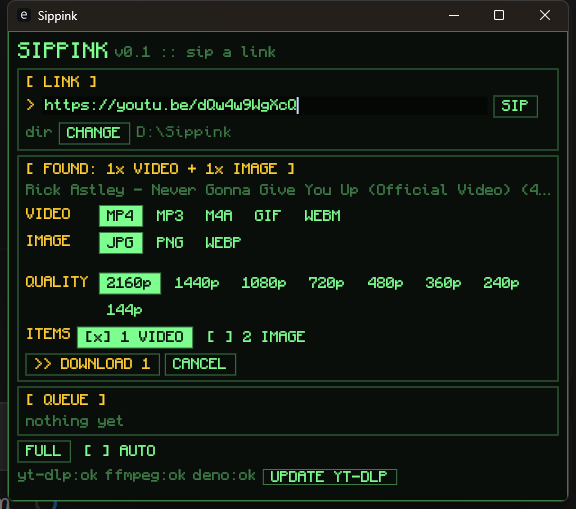
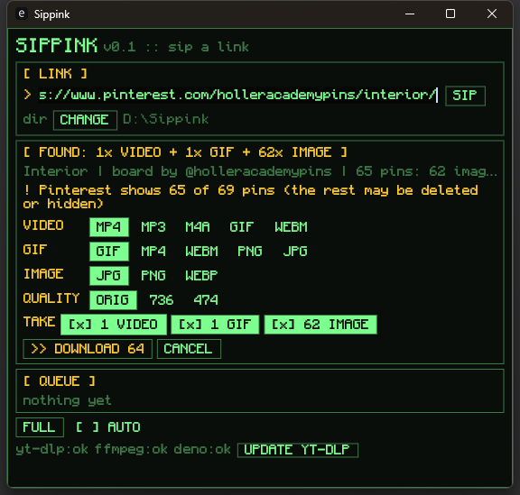
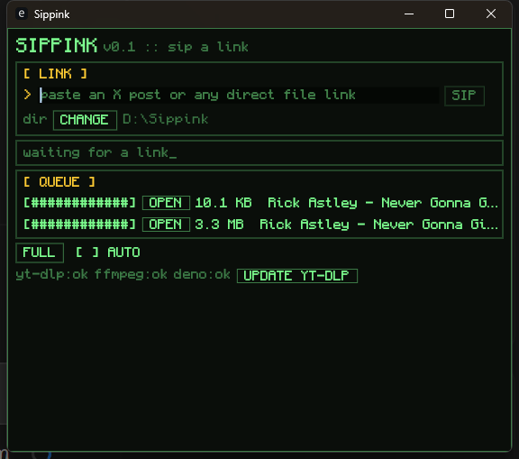

<p align="center">
  
</p>

<h1 align="center">Sippink</h1>

<p align="center">
  <i>sip</i> + <i>link</i>: paste a link, get the media.<br>
  A small Windows tray app (Rust + egui) with a terminal look, for YouTube,
  X / Twitter, Pinterest and plain file links.
</p>

<p align="center">
  <a href="https://github.com/PUTTIPONG-Boss/Sippink/releases/latest">Download the latest sippink.exe</a>
</p>

<p align="center">
  
  
</p>

## What it does

1. Paste a link and press **SIP** (or Enter).
2. Sippink looks inside first and tells you what's there: `VIDEO`, `GIF`,
   `IMAGE`, or a plain `FILE`, and how many.
3. Pick the output format and quality, untick items you don't want, then
   press **DOWNLOAD**.

| Source is | You can save as |
|---|---|
| VIDEO | MP4, MP3, M4A, GIF, WEBM |
| GIF   | GIF, MP4, WEBM, PNG, JPG |
| IMAGE | JPG, PNG, WEBP |

<p align="center">
  
</p>

Quality: every size the source has (`2160p 1440p 1080p ...`,
`3840x2160 ...`, `ORIG LARGE SMALL`). Other items in the same post follow by
rank, so picking the 2nd-biggest video also takes the 2nd-biggest thumbnail.

`AUTO` skips the chooser and reuses the last formats you picked.

### Sites

- **X / Twitter**: posts with photos, videos, GIFs, several media, quote posts
  and app cards. Works with `x.com`, `twitter.com`, `mobile.*`, `fxtwitter`,
  `vxtwitter`, `fixupx`. Uses X's public embed endpoint, so no login is
  needed. Posts that need a login (sensitive, age-restricted, protected) are
  not supported yet.
- **YouTube** (via [yt-dlp](https://github.com/yt-dlp/yt-dlp)): `watch`,
  `youtu.be`, Shorts, `music.`, `embed`, `live` links. Every real size from
  144p up to 4K/8K; the cover image is offered as an extra item (unticked).
  MP3/M4A fetch only the audio, GIF only the video, WEBM grabs VP9/Opus
  directly so nothing is re-encoded, MP4 prefers H.264/AAC so it plays
  everywhere. Playlists and live streams are not supported yet.
- **Pinterest**: photos, animated GIFs, video pins, idea/story pins
  (image and video pages, including HLS-only clips), carousels (mixed
  pictures and clips, each its own item) and pins that embed a Vimeo /
  YouTube video (fetched through yt-dlp, the pin image offered as a cover).
  Works with `pinterest.<any country>/pin/...` and `pin.it` short links. Uses
  the site's own public resources, so no login. `/pin/e1_...` links copied
  from logged-out search are temporary session tokens the site itself can't
  open; use the pin's Share link instead.
- **Pinterest boards, sections and profiles**:

  | Link | Downloads into |
  |---|---|
  | `/<user>/<board>/` | `<board>/` |
  | `/<user>/<board>/<section>/` | `<board>/<section>/` |
  | `/<user>/` (or `_saved`) | `<user>/<board>/` for every board |
  | `/<user>/_created/` | `<user>/created/` |

  Scanning shows live progress and can be cancelled. Big sets get per-type
  toggles (`[x] 62 IMAGE  [x] 1 GIF ...`) instead of one button per pin.
  Downloads run 4 at a time, and running the same board again only fetches
  pins that aren't in its folder yet.

  Logged out, Pinterest's board feed stops early (anywhere from 24 to 200
  pins). Sippink then looks through the owner's pin list, which pages all
  the way and says which board each pin is on, newest first. That finds
  nearly everything for most boards, but an old board on a huge account
  (one test account had 173,556 pins) would take an hour, so the search
  stops after the owner's newest 5,000 pins (about two minutes) and says
  how many it found; **SEARCH ALL** (or `--deep`) keeps going. Board
  sections can't be completed this way, so a capped section says so.
- **HLS streams** (`.m3u8`): best rendition plus its audio, copied into MP4
  by ffmpeg without re-encoding.
- **Any direct file link**: type detected from `Content-Type` / extension.

Planned: Reddit.

## Helper tools

The footer shows `GET ...` buttons for the helpers that are missing; each
downloads the official Windows build into `%APPDATA%\sippink\bin`:

| Tool | Needed for | From |
|---|---|---|
| yt-dlp | YouTube | github.com/yt-dlp/yt-dlp releases |
| ffmpeg | MP3 / GIF / WEBM conversions, YouTube above 360p | gyan.dev essentials build |
| deno | optional; lets yt-dlp solve YouTube's JS checks so no formats go missing | github.com/denoland/deno releases |

**UPDATE YT-DLP** runs `yt-dlp -U`; do that first when YouTube downloads
start failing.

Sippink also finds tools set in `SIPPINK_FFMPEG` / `SIPPINK_YTDLP` /
`SIPPINK_DENO`, next to `sippink.exe`, on `PATH`, or installed by winget.
Without ffmpeg, formats that need it are greyed out and X GIFs are saved as
MP4 loops. JPG/PNG/WEBP conversions are built in.

## Command line

Same pipeline as the window, handy for scripts and testing (use a debug
build, release builds have no console):

```
sippink --get <url> [--fmt mp4|mp3|m4a|gif|webm|jpg|png|webp] [--quality best|medium|small|1080p|...] [--out dir] [--probe] [--all] [--limit n] [--deep]
sippink --install yt-dlp|ffmpeg|deno
sippink <url> [--out dir]        # open the window with this link
```

## Build

```
cargo build --release
cargo test                 # offline tests
cargo test -- --ignored    # live tests against x.com
```

## License

[MIT](LICENSE). The bundled font, [Monocraft](https://github.com/IdreesInc/Monocraft),
is under the SIL Open Font License 1.1 (`assets/Monocraft-OFL.txt`).
yt-dlp, ffmpeg and deno are not bundled; the app downloads their official
builds on request, and they keep their own licenses.

## Branches and releases

| Branch | What it is |
|---|---|
| `main` | Released versions only. Every commit here has a `vX.Y.Z` tag. |
| `master` | Work in progress. Try things here; CI builds and tests every push. |
| `feat/...`, `fix/...` | One change each, branched from `master`. |

Work on something:

```
git switch master
git pull
git switch -c fix/tray-menu
# ...commit...
git switch master
git merge fix/tray-menu
git push                    # CI builds and tests it
```

Release it once `master` is good (example: 0.1.1):

```
# on master: set version = "0.1.1" in Cargo.toml
cargo build                 # updates Cargo.lock
git commit -am "Release v0.1.1"
git push
git switch main
git merge --ff-only master
git tag v0.1.1
git push origin main v0.1.1
git switch master
```

The tag push makes GitHub Actions build `sippink-v0.1.1-windows-x64.exe`
and publish it on the Releases page. It refuses tags that aren't on `main`
or don't match `Cargo.toml`.
